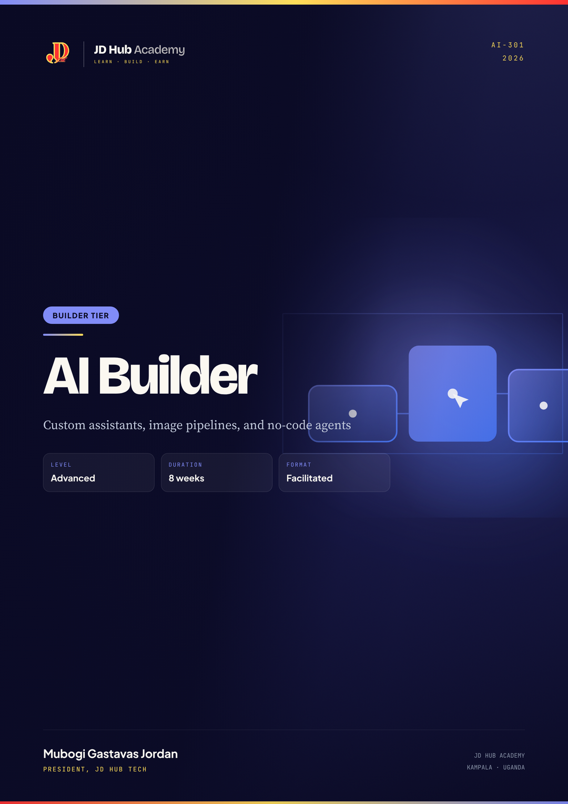

# AI Builder

> Custom assistants, image pipelines, and no-code agents

**Course code:** AI-301 &nbsp;·&nbsp; **Level:** Advanced — comfortable with systems and data
&nbsp;·&nbsp; **Duration:** 8 weeks · 16 sessions · 32 contact hours
&nbsp;·&nbsp; **Book:** 20 pages

**Author:** Mubogi Gastavas Jordan, President, JD Hub Tech · JD Hub Academy

---

## What this course is

Build things other people use. Custom GPTs and Gemini Gems trained on your own documents, brand-consistent image generation pipelines, voice and video production, retrieval over your own knowledge base, and agents that take actions rather than just answering.

**Who it is for:** Operations leads, product owners, in-house tech staff, consultants.

**Prerequisites:** AI-201, or proven experience shipping an AI workflow.

**Next step:** AI-401 Specialist

---

## What you will be able to do

- Build a custom assistant grounded in your organisation's documents
- Design a brand-locked image generation system
- Produce voiceover and short video with AI, legally and consistently
- Build retrieval-augmented assistants and test them for hallucination
- Deploy a customer-facing bot with escalation rules
- Design an agent that takes actions safely

---

## Contents

- **Module 1 — What Changes at Builder Level**
  - Lesson 1.1 — The four things you will build
  - Lesson 1.2 — The builder's rule: grounding beats cleverness
  - Lesson 1.3 — What you need before you start
- **Module 2 — Grounded Assistants**
  - Lesson 2.1 — The build, step by step
  - Lesson 2.2 — The instruction block
  - Lesson 2.3 — Scoring the test set
- **Module 3 — Retrieval: When the Documents Are Too Many**
  - Lesson 3.1 — The limit of pasting
  - Lesson 3.2 — What makes retrieval fail
  - Lesson 3.3 — Testing retrieval specifically
- **Module 4 — The Brand-Locked Image System**
  - Lesson 4.1 — Why consistency is the whole job
  - Lesson 4.2 — The style specification
  - Lesson 4.3 — The four jobs images actually do
  - Lesson 4.4 — The rejection habit
- **Module 5 — Voice and Video Production**
  - Lesson 5.1 — Voiceover
  - Lesson 5.2 — Short video, cheaply
  - Lesson 5.3 — The repurposing engine
  - Lesson 5.4 — The honesty rules
- **Module 6 — Agents: When AI Takes Actions**
  - Lesson 6.1 — What an agent is
  - Lesson 6.2 — The permission ladder
  - Lesson 6.3 — Designing the guardrails
- **Module 7 — Testing and Evaluation**
  - Lesson 7.1 — The evaluation set
  - Lesson 7.2 — Red teaming
  - Lesson 7.3 — Monitoring after launch
- **Module 8 — Capstone: Ship a Tool**
  - Lesson 8.1 — The brief
  - Lesson 8.2 — The rubric
- **Module 9 — The Next Tier**

---

## The book

- [Download the PDF](../../build/AI-301-ai-builder.pdf) — complete course book, print-ready
- [Cover image](../../assets/covers/ai-builder.png)
- [Wide banner](../../assets/covers/ai-builder-wide.png)
- [Concept illustration](../../assets/illustrations/ai-builder.png)

---

## Assessment

Every course in this library is assessed against a published rubric, printed in
the final module of the book. The pass mark is 60 percent, and the practical
component is mandatory regardless of total score.

The certificate states the learner's name, the course title, contact hours, tools
covered, the capstone title, and the date.

---

Copyright © 2026 Mubogi Gastavas Jordan, President, JD Hub Tech. All rights reserved.
See [LICENSE](../../LICENSE).
