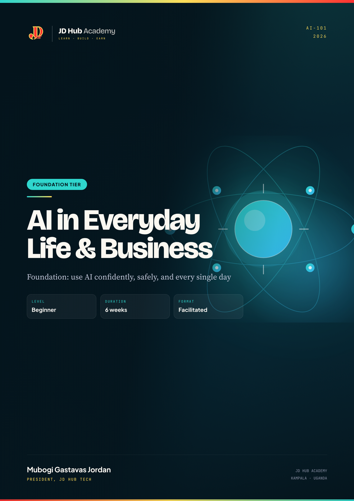

# AI in Everyday Life & Business

> Foundation: use AI confidently, safely, and every single day

**Course code:** AI-101 &nbsp;·&nbsp; **Level:** Beginner — no prior AI knowledge
&nbsp;·&nbsp; **Duration:** 6 weeks · 12 sessions · 24 contact hours
&nbsp;·&nbsp; **Book:** 40 pages

**Author:** Mubogi Gastavas Jordan, President, JD Hub Tech · JD Hub Academy

---

## What this course is

The starting point for anyone who has been told to 'learn AI' and given no instructions. You will use ChatGPT, Google Gemini, Meta AI and Canva on your own real work — not on sample exercises — and leave with a personal AI workflow you actually use.

**Who it is for:** Small business owners, employees, job seekers, students, NGO staff.

**Prerequisites:** A smartphone or laptop, a Google account, WhatsApp, and basic typing.

**Next step:** AI-201 Practitioner

---

## What you will be able to do

- Explain what generative AI is, and the three ways it fails
- Write prompts that get usable answers on the first or second try
- Run ChatGPT, Gemini and Meta AI confidently for daily work
- Produce a week of social content in under an hour
- Draft business documents in a fraction of the usual time
- Verify AI output and spot invented facts
- Apply a personal and business AI policy

---

## Contents

- **Module 1 — What Artificial Intelligence Actually Is**
  - Lesson 1.1 — It predicts. It does not know.
  - Lesson 1.2 — The three failure modes
  - Lesson 1.3 — What AI is not
  - Lesson 1.4 — Where AI genuinely earns its keep
- **Module 2 — Prompting: Getting Usable Answers**
  - Lesson 2.1 — The R-T-C-F structure
  - Lesson 2.2 — Iteration: the first answer is a draft
  - Lesson 2.3 — Giving it something to work with
  - Lesson 2.4 — Voice: talking to the machine
- **Module 3 — ChatGPT: The General Workhorse**
  - Lesson 3.1 — What it is good at, and what to hand elsewhere
  - Lesson 3.2 — The five work patterns
  - Lesson 3.3 — Working with files
  - Lesson 3.4 — Custom instructions: stop repeating yourself
- **Module 4 — Google Gemini in Daily Work**
  - Lesson 4.1 — The assistant inside your inbox
  - Lesson 4.2 — Docs and Sheets
  - Lesson 4.3 — Research with sources
  - Lesson 4.4 — Knowing what it can see
- **Module 5 — Meta AI in WhatsApp, Instagram and Facebook**
  - Lesson 5.1 — Why this matters more than it sounds
  - Lesson 5.2 — The reply bank
  - Lesson 5.3 — Captions and images that do not look generated
  - Lesson 5.4 — Turning a messy group into decisions
- **Module 6 — Canva: Design Without a Designer**
  - Lesson 6.1 — The four rules that do most of the work
  - Lesson 6.2 — The 30-minute poster sprint
  - Lesson 6.3 — Magic Studio: what each tool is for
  - Lesson 6.4 — Export without embarrassment
- **Module 7 — The Content Engine: One Hour, One Week**
  - Lesson 7.1 — The engine, in five steps
  - Lesson 7.2 — The prompt chain
  - Lesson 7.3 — The repurposing multiplier
- **Module 8 — Numbers, Admin and Money**
  - Lesson 8.1 — From plain English to formula
  - Lesson 8.2 — Cleaning messy data
  - Lesson 8.3 — Documents that carry money
  - Lesson 8.4 — The monthly report nobody has time to write
- **Module 9 — Customer Service and Sales**
  - Lesson 9.1 — What a good bot does
  - Lesson 9.2 — Building it from your own content
  - Lesson 9.3 — The break-the-bot exercise
- **Module 10 — Research You Can Defend**
  - Lesson 10.1 — Tools that cite, and what citing means
  - Lesson 10.2 — The verification ritual
  - Lesson 10.3 — Interrogating long documents
- **Module 11 — Saving Time Every Week: Notes and Automation**
  - Lesson 11.1 — Capture meetings without taking notes
  - Lesson 11.2 — Trigger, action, result
  - Lesson 11.3 — The rule for what to automate
- **Module 12 — Ethics, Privacy and Your AI Policy**
  - Lesson 12.1 — The data rule
  - Lesson 12.2 — Honesty and disclosure
  - Lesson 12.3 — Bias, and who is missing
  - Lesson 12.4 — Your one-page AI policy
- **Module 13 — Capstone: Build Your Own Workflow**
  - Lesson 13.1 — The brief
  - Lesson 13.2 — The rubric
  - Lesson 13.3 — Present in five minutes
- **Module 14 — Ninety Days After the Course**
  - Lesson 14.1 — The habit that makes it stick
  - Lesson 14.2 — Where to go next

---

## The book

- [Download the PDF](../../build/AI-101-ai-foundation.pdf) — complete course book, print-ready
- [Cover image](../../assets/covers/ai-foundation.png)
- [Wide banner](../../assets/covers/ai-foundation-wide.png)
- [Concept illustration](../../assets/illustrations/ai-foundation.png)

---

## Assessment

Every course in this library is assessed against a published rubric, printed in
the final module of the book. The pass mark is 60 percent, and the practical
component is mandatory regardless of total score.

The certificate states the learner's name, the course title, contact hours, tools
covered, the capstone title, and the date.

---

Copyright © 2026 Mubogi Gastavas Jordan, President, JD Hub Tech. All rights reserved.
See [LICENSE](../../LICENSE).
