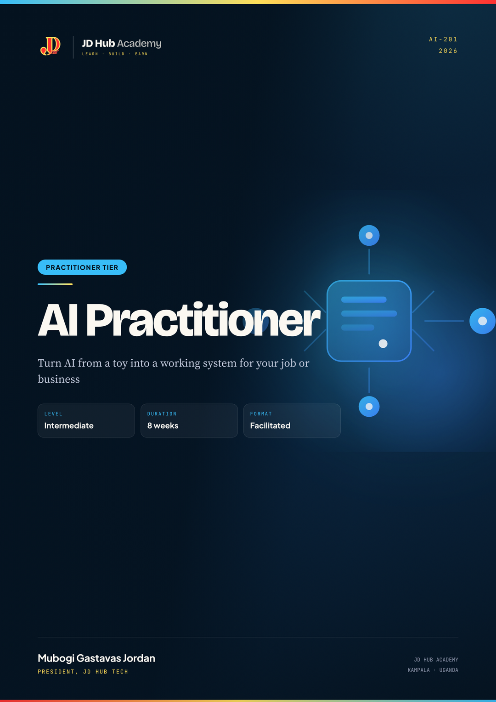

# AI Practitioner

> Turn AI from a toy into a working system for your job or business

**Course code:** AI-201 &nbsp;·&nbsp; **Level:** Intermediate — AI-101 or equivalent confidence
&nbsp;·&nbsp; **Duration:** 8 weeks · 16 sessions · 32 contact hours
&nbsp;·&nbsp; **Book:** 26 pages

**Author:** Mubogi Gastavas Jordan, President, JD Hub Tech · JD Hub Academy

---

## What this course is

You already use AI. Now you build systems with it. This tier covers prompt architecture, reusable prompt libraries, AI-assisted research you can defend, document intelligence, content engines, and simple automation that runs without you.

**Who it is for:** Supervisors, administrators, marketers, teachers, founders.

**Prerequisites:** AI-101, or six months of regular AI use.

**Next step:** AI-301 Builder

---

## What you will be able to do

- Design multi-step prompt chains that hold quality across a team
- Build and maintain a shared prompt library for an organisation
- Interrogate long documents with NotebookLM and defend your findings
- Run a repeatable weekly content engine across four platforms
- Automate recurring admin with Zapier or Make
- Measure time and cost saved, with evidence

---

## Contents

- **Module 1 — From User to Operator**
  - Lesson 1.1 — Why ad-hoc prompting does not scale
  - Lesson 1.2 — The three artefacts of an operator
  - Lesson 1.3 — The economics that justify this
- **Module 2 — Prompt Architecture**
  - Lesson 2.1 — Anatomy of a production prompt
  - Lesson 2.2 — Variables and templates
  - Lesson 2.3 — Testing a prompt
  - Lesson 2.4 — Prompt chains
- **Module 3 — The Shared Prompt Library**
  - Lesson 3.1 — Structure that survives contact with staff
  - Lesson 3.2 — The entry template
  - Lesson 3.3 — Getting people to actually use it
- **Module 4 — Document Intelligence**
  - Lesson 4.1 — Grounded question answering
  - Lesson 4.2 — The contradiction hunt
  - Lesson 4.3 — When to trust the summary
- **Module 5 — The Content Engine at Team Scale**
  - Lesson 5.1 — The pipeline
  - Lesson 5.2 — The brief that makes drafting easy
  - Lesson 5.3 — Measuring without vanity
- **Module 6 — Automation That Actually Runs**
  - Lesson 6.1 — The reliability test
  - Lesson 6.2 — Patterns worth building
  - Lesson 6.3 — Patterns to refuse
- **Module 7 — Measurement and Reporting**
  - Lesson 7.1 — What to measure
  - Lesson 7.2 — Measuring time honestly
  - Lesson 7.3 — The one-page report
- **Module 8 — Training Your Colleagues**
  - Lesson 8.1 — Three kinds of learner
  - Lesson 8.2 — The 45-minute session format
  - Lesson 8.3 — What to tell people who are afraid
- **Module 9 — Capstone: A Department-Level System**
  - Lesson 9.1 — The brief
  - Lesson 9.2 — The rubric
  - Lesson 9.3 — Presenting to management
- **Module 10 — Where to Go Next**

---

## The book

- [Download the PDF](../../build/AI-201-ai-practitioner.pdf) — complete course book, print-ready
- [Cover image](../../assets/covers/ai-practitioner.png)
- [Wide banner](../../assets/covers/ai-practitioner-wide.png)
- [Concept illustration](../../assets/illustrations/ai-practitioner.png)

---

## Assessment

Every course in this library is assessed against a published rubric, printed in
the final module of the book. The pass mark is 60 percent, and the practical
component is mandatory regardless of total score.

The certificate states the learner's name, the course title, contact hours, tools
covered, the capstone title, and the date.

---

Copyright © 2026 Mubogi Gastavas Jordan, President, JD Hub Tech. All rights reserved.
See [LICENSE](../../LICENSE).
