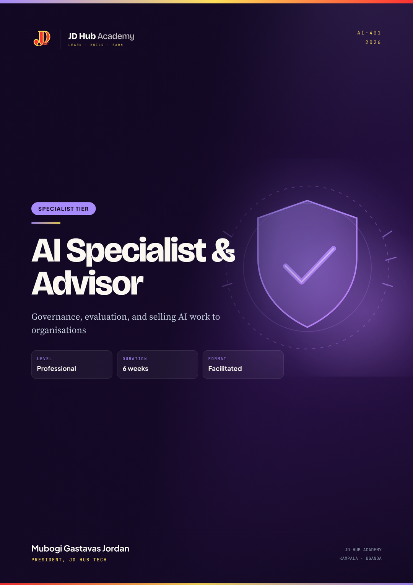

# AI Specialist & Advisor

> Governance, evaluation, and selling AI work to organisations

**Course code:** AI-401 &nbsp;·&nbsp; **Level:** Professional — for consultants and organisational leads
&nbsp;·&nbsp; **Duration:** 6 weeks · 12 sessions · 24 contact hours
&nbsp;·&nbsp; **Book:** 21 pages

**Author:** Mubogi Gastavas Jordan, President, JD Hub Tech · JD Hub Academy

---

## What this course is

The tier that turns skill into income and authority. AI governance and policy, model evaluation, procurement, data protection, staff training design, and the commercial side: scoping, pricing and delivering AI consulting engagements.

**Who it is for:** Consultants, IT managers, compliance officers, trainers, founders.

**Prerequisites:** AI-301, or equivalent delivery experience.

**Next step:** Alumni network & specialist clinics

---

## What you will be able to do

- Write and roll out an organisational AI policy that survives audit
- Evaluate and compare AI tools on evidence, not marketing
- Assess risk, data protection and compliance obligations
- Design and deliver AI training for staff at three skill levels
- Scope, price and deliver an AI consulting engagement
- Build a defensible AI service offering and price it

---

## Contents

- **Module 1 — The Specialist's Job**
  - Lesson 1.1 — The three questions every client asks
  - Lesson 1.2 — What separates a specialist from an enthusiast
- **Module 2 — AI Governance and Policy**
  - Lesson 2.1 — What a policy must do
  - Lesson 2.2 — The structure that survives audit
  - Lesson 2.3 — The data classification that does the work
  - Lesson 2.4 — The roll-out that does not fail
- **Module 3 — Evaluation and Procurement**
  - Lesson 3.1 — The evaluation grid
  - Lesson 3.2 — Running a blind test
  - Lesson 3.3 — The three-year cost
- **Module 4 — Data Protection and Risk**
  - Lesson 4.1 — The questions to ask any vendor
  - Lesson 4.2 — The risk register
  - Lesson 4.3 — What the law expects
- **Module 5 — Training Design at Scale**
  - Lesson 5.1 — Three curricula, not one
  - Lesson 5.2 — The training that transfers
  - Lesson 5.3 — Measuring training
- **Module 6 — Consulting: Scoping, Pricing, Delivering**
  - Lesson 6.1 — The scoping conversation
  - Lesson 6.2 — Pricing models
  - Lesson 6.3 — The proposal that wins
  - Lesson 6.4 — Delivery discipline
- **Module 7 — Building Your Practice**
  - Lesson 7.1 — The service ladder
  - Lesson 7.2 — What to publish
  - Lesson 7.3 — The ethics that protect you
- **Module 8 — Capstone: The Advisory Pack**
  - Lesson 8.1 — The brief
  - Lesson 8.2 — The rubric

---

## The book

- [Download the PDF](../../build/AI-401-ai-specialist.pdf) — complete course book, print-ready
- [Cover image](../../assets/covers/ai-specialist.png)
- [Wide banner](../../assets/covers/ai-specialist-wide.png)
- [Concept illustration](../../assets/illustrations/ai-specialist.png)

---

## Assessment

Every course in this library is assessed against a published rubric, printed in
the final module of the book. The pass mark is 60 percent, and the practical
component is mandatory regardless of total score.

The certificate states the learner's name, the course title, contact hours, tools
covered, the capstone title, and the date.

---

Copyright © 2026 Mubogi Gastavas Jordan, President, JD Hub Tech. All rights reserved.
See [LICENSE](../../LICENSE).
