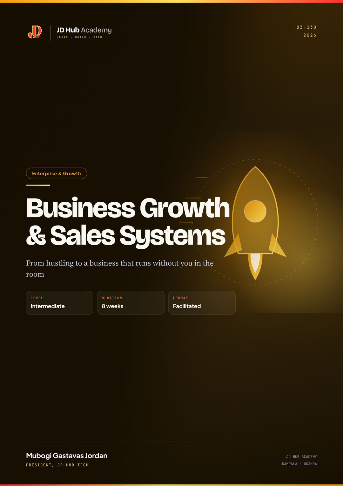

# Business Growth & Sales Systems

> From hustling to a business that runs without you in the room

**Course code:** BZ-230 &nbsp;·&nbsp; **Level:** Intermediate
&nbsp;·&nbsp; **Duration:** 8 weeks · 16 sessions · 32 contact hours
&nbsp;·&nbsp; **Book:** 21 pages

**Author:** Mubogi Gastavas Jordan, President, JD Hub Tech · JD Hub Academy

---

## What this course is

The gap between a hustle and a business is systems. Pricing that protects your margin, a sales process that does not depend on charm, customer retention that costs less than acquisition, and the numbers a founder must know every week. Heavy on templates, light on theory.

**Who it is for:** Founders, shop owners, service providers, SACCO entrepreneurs.

**Prerequisites:** An operating business, side hustle, or firm intention to start one.

**Next step:** Financial & SACCO Management, or AI-201

---

## What you will be able to do

- Price a product or service using cost, value and market logic
- Build a repeatable sales process from enquiry to repeat purchase
- Track the five numbers that predict survival
- Design a customer retention and referral system
- Document a process so staff can run it without you
- Decide whether to grow, hold, or exit
- Write a one-page growth plan a lender would read

---

## Contents

- **Module 1 — The Difference Between a Hustle and a Business**
  - Lesson 1.1 — The four stages
  - Lesson 1.2 — The five numbers
  - Lesson 1.3 — Why profitable businesses run out of cash
- **Module 2 — Pricing That Protects You**
  - Lesson 2.1 — Three ways to price
  - Lesson 2.2 — The margin trap
  - Lesson 2.3 — Raising prices without losing customers
- **Module 3 — The Sales Process**
  - Lesson 3.1 — Sales is a process, not a personality
  - Lesson 3.2 — The three qualifying questions
  - Lesson 3.3 — Handling objections without arguing
  - Lesson 3.4 — Documenting the process
- **Module 4 — Customers Worth Keeping**
  - Lesson 4.1 — The economics of retention
  - Lesson 4.2 — The retention system
  - Lesson 4.3 — Referrals, systematically
- **Module 5 — Systems and Delegation**
  - Lesson 5.1 — The process document
  - Lesson 5.2 — What to delegate first
  - Lesson 5.3 — The delegation conversation
- **Module 6 — The Weekly Operating Rhythm**
  - Lesson 6.1 — Why rhythm beats effort
  - Lesson 6.2 — The 90-minute weekly review
  - Lesson 6.3 — The monthly and quarterly layers
- **Module 7 — Growth Decisions**
  - Lesson 7.1 — The three growth routes
  - Lesson 7.2 — The capacity question
  - Lesson 7.3 — When not to grow
- **Module 8 — Using AI in the Business**
  - Lesson 8.1 — Where it pays
  - Lesson 8.2 — Where it does not
  - Lesson 8.3 — The one workflow to build first
- **Module 9 — Capstone: The One-Page Growth Plan**
  - Lesson 9.1 — The brief
  - Lesson 9.2 — The rubric

---

## The book

- [Download the PDF](../../build/BZ-230-business-growth.pdf) — complete course book, print-ready
- [Cover image](../../assets/covers/business-growth.png)
- [Wide banner](../../assets/covers/business-growth-wide.png)
- [Concept illustration](../../assets/illustrations/business-growth.png)

---

## Assessment

Every course in this library is assessed against a published rubric, printed in
the final module of the book. The pass mark is 60 percent, and the practical
component is mandatory regardless of total score.

The certificate states the learner's name, the course title, contact hours, tools
covered, the capstone title, and the date.

---

Copyright © 2026 Mubogi Gastavas Jordan, President, JD Hub Tech. All rights reserved.
See [LICENSE](../../LICENSE).
