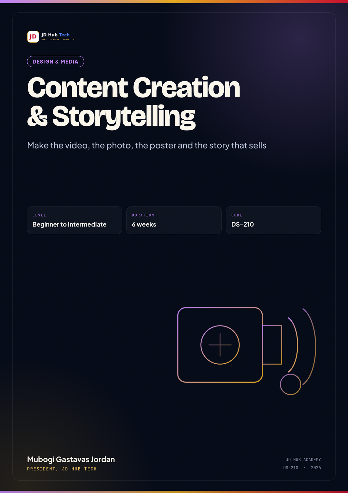

# Content Creation & Storytelling

> Make the video, the photo, the poster and the story that sells

**Course code:** DS-210 &nbsp;·&nbsp; **Level:** Beginner to Intermediate
&nbsp;·&nbsp; **Duration:** 6 weeks · 12 sessions · 24 contact hours
&nbsp;·&nbsp; **Book:** 21 pages

**Author:** Mubogi Gastavas Jordan, President, JD Hub Tech · JD Hub Academy

---

## What this course is

A phone is enough. This course turns a learner into a producer: shooting clean video on a cheap handset, recording usable audio in a noisy room, editing with CapCut, writing scripts that hold attention, and using current AI video, image and voice tools without producing the same soulless output as everyone else.

**Who it is for:** Creators, church media teams, NGO communicators, small brands.

**Prerequisites:** A smartphone with a camera. That is the whole kit list.

**Next step:** Digital Marketing & Business Growth

---

## What you will be able to do

- Shoot video on a phone that looks deliberate, not accidental
- Record clean audio in a noisy environment
- Write a 30-second script with a hook, a point and a call to action
- Edit to a finished cut with captions, music and b-roll
- Use AI for voiceover, image and video generation responsibly
- Build a content series that people return to
- Publish consistently without burning out

---

## Contents

- **Module 1 — The Phone Is the Studio**
  - Lesson 1.1 — What "good content" actually means
  - Lesson 1.2 — The three content jobs
  - Lesson 1.3 — The kit you already own
- **Module 2 — Shooting Video That Looks Deliberate**
  - Lesson 2.1 — Light
  - Lesson 2.2 — Sound
  - Lesson 2.3 — Framing
  - Lesson 2.4 — The shot list
- **Module 3 — Scripting for Attention**
  - Lesson 3.1 — The hook, the body, the ask
  - Lesson 3.2 — Writing for the ear
  - Lesson 3.3 — The 30-second script template
  - Lesson 3.4 — Using AI to script without sounding like AI
- **Module 4 — Editing with CapCut**
  - Lesson 4.1 — The four-pass method
  - Lesson 4.2 — Captions are not optional
  - Lesson 4.3 — Music without legal risk
  - Lesson 4.4 — The export settings
- **Module 5 — AI in the Production Line**
  - Lesson 5.1 — Where AI genuinely helps
  - Lesson 5.2 — Synthetic voice, used honestly
  - Lesson 5.3 — Generated images in content
  - Lesson 5.4 — The repurposing chain
- **Module 6 — Building a Series People Return To**
  - Lesson 6.1 — Why series beat one-offs
  - Lesson 6.2 — Formats that survive
  - Lesson 6.3 — The content bank
- **Module 7 — Publishing and Measuring**
  - Lesson 7.1 — The minimum viable publishing system
  - Lesson 7.2 — The numbers that matter
  - Lesson 7.3 — The honest review
- **Module 8 — Making It Pay**
  - Lesson 8.1 — The three routes to income
  - Lesson 8.2 — Pricing content work
  - Lesson 8.3 — The portfolio that sells
- **Module 9 — Capstone: A Content Operation**
  - Lesson 9.1 — The brief
  - Lesson 9.2 — The rubric

---

## The book

- [Download the PDF](../../build/DS-210-content-creation.pdf) — complete course book, print-ready
- [Cover image](../../assets/covers/content-creation.png)
- [Wide banner](../../assets/covers/content-creation-wide.png)
- [Concept illustration](../../assets/illustrations/content-creation.png)

---

## Assessment

Every course in this library is assessed against a published rubric, printed in
the final module of the book. The pass mark is 60 percent, and the practical
component is mandatory regardless of total score.

The certificate states the learner's name, the course title, contact hours, tools
covered, the capstone title, and the date.

---

Copyright © 2026 Mubogi Gastavas Jordan, President, JD Hub Tech. All rights reserved.
See [LICENSE](../../LICENSE).
