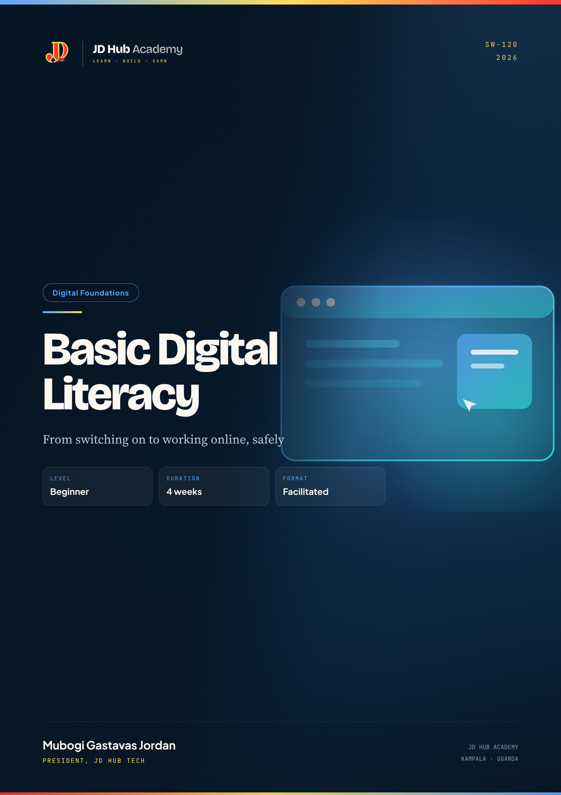

# Basic Digital Literacy

> From switching on to working online, safely

**Course code:** SW-120 &nbsp;·&nbsp; **Level:** Beginner — no computer experience assumed
&nbsp;·&nbsp; **Duration:** 4 weeks · 8 sessions · 16 contact hours
&nbsp;·&nbsp; **Book:** 20 pages

**Author:** Mubogi Gastavas Jordan, President, JD Hub Tech · JD Hub Academy

---

## What this course is

The course for adults who have been handed a computer and expected to know what to do. No assumptions, no jargon, and no shame. By the end you can file, email, search, pay, and protect yourself online.

**Who it is for:** Adult learners, market traders, community leaders, new staff.

**Prerequisites:** None. Literally none.

**Next step:** Microsoft Word, then AI-101

---

## What you will be able to do

- Operate a computer, phone, and file system without help
- Create, save, find and share documents
- Use email and WhatsApp for work correspondence
- Search effectively and judge whether a source is trustworthy
- Recognise scams, phishing, and mobile-money fraud
- Complete a task end-to-end: apply, register, or pay online

---

## Contents

- **Module 1 — Starting From Zero**
  - Lesson 1.1 — What the machine is
  - Lesson 1.2 — Turning it on, and off
  - Lesson 1.3 — The mouse and the touchscreen
- **Module 2 — Files, Folders and Finding Things**
  - Lesson 2.1 — The filing cabinet idea
  - Lesson 2.2 — A folder structure that works
  - Lesson 2.3 — Search
- **Module 3 — Email Without Fear**
  - Lesson 3.1 — The parts of an email
  - Lesson 3.2 — Writing a professional email
  - Lesson 3.3 — Attachments and the size problem
  - Lesson 3.4 — Recognising a scam
- **Module 4 — Searching the Internet Properly**
  - Lesson 4.1 — How search works, briefly
  - Lesson 4.2 — Better searches
  - Lesson 4.3 — Judging a source
- **Module 5 — Documents and Spreadsheets**
  - Lesson 5.1 — The word processor
  - Lesson 5.2 — The spreadsheet
  - Lesson 5.3 — Your first useful sheet
- **Module 6 — Staying Safe Online**
  - Lesson 6.1 — Passwords
  - Lesson 6.2 — The scams that actually catch people
  - Lesson 6.3 — The one rule
- **Module 7 — Doing Something Real**
  - Lesson 7.1 — The complete task
  - Lesson 7.2 — Keeping proof
- **Module 8 — Capstone**
  - Lesson 8.1 — The brief
  - Lesson 8.2 — The rubric

---

## The book

- [Download the PDF](../../build/SW-120-digital-literacy.pdf) — complete course book, print-ready
- [Cover image](../../assets/covers/digital-literacy.png)
- [Wide banner](../../assets/covers/digital-literacy-wide.png)
- [Concept illustration](../../assets/illustrations/digital-literacy.png)

---

## Assessment

Every course in this library is assessed against a published rubric, printed in
the final module of the book. The pass mark is 60 percent, and the practical
component is mandatory regardless of total score.

The certificate states the learner's name, the course title, contact hours, tools
covered, the capstone title, and the date.

---

Copyright © 2026 Mubogi Gastavas Jordan, President, JD Hub Tech. All rights reserved.
See [LICENSE](../../LICENSE).
