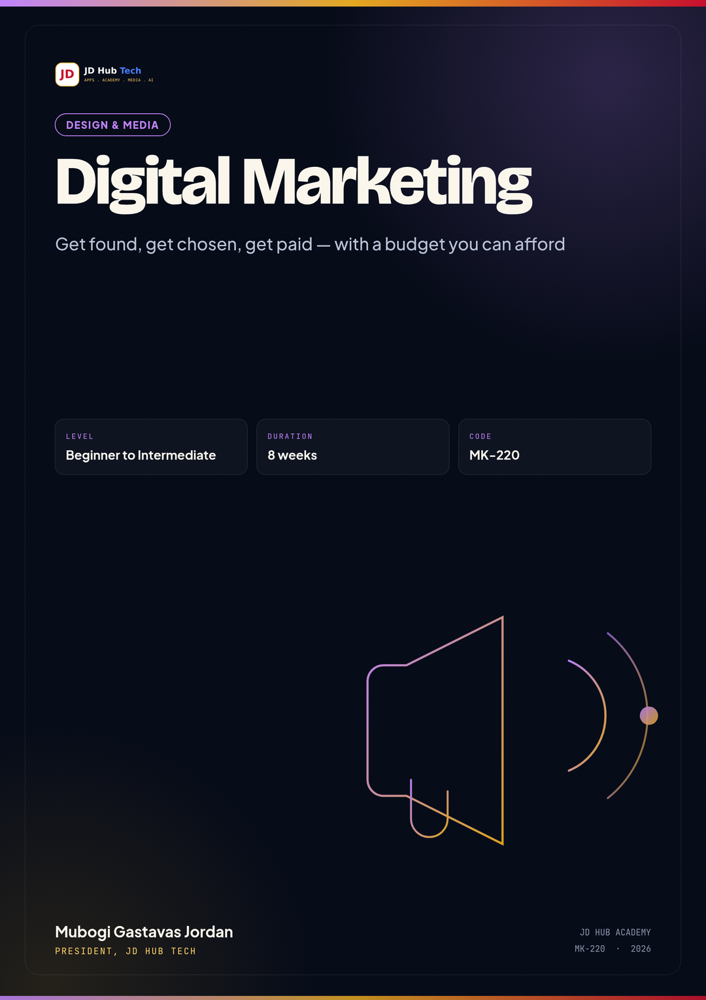

# Digital Marketing

> Get found, get chosen, get paid — with a budget you can afford

**Course code:** MK-220 &nbsp;·&nbsp; **Level:** Beginner to Intermediate
&nbsp;·&nbsp; **Duration:** 8 weeks · 16 sessions · 32 contact hours
&nbsp;·&nbsp; **Book:** 20 pages

**Author:** Mubogi Gastavas Jordan, President, JD Hub Tech · JD Hub Academy

---

## What this course is

Marketing taught as arithmetic, not magic. Who your buyer is, where they already are, what makes them choose you, and how to spend the smallest possible amount of money finding out. Covers WhatsApp Business, Facebook and Instagram ads, Google Business Profile, TikTok, email and the AI tools that cut production cost to near zero.

**Who it is for:** Business owners, marketers, freelancers, NGO programme staff.

**Prerequisites:** Basic smartphone use. A business, cause or service to market.

**Next step:** Business Growth & Sales Systems

---

## What you will be able to do

- Define a buyer and a positioning statement you can defend
- Set up WhatsApp Business, a Google Business Profile and a Facebook page properly
- Run a small paid campaign and read the results honestly
- Write an offer that converts without discounting to death
- Build a simple funnel and measure where it leaks
- Calculate cost per lead and cost per sale
- Decide when to spend more and when to stop

---

## Contents

- **Module 1 — Marketing Is Arithmetic**
  - Lesson 1.1 — The four numbers you must know
  - Lesson 1.2 — Why most marketing spend is wasted
  - Lesson 1.3 — The marketing stack for a small business
- **Module 2 — Knowing Who You Serve**
  - Lesson 2.1 — The buyer, specifically
  - Lesson 2.2 — Positioning
  - Lesson 2.3 — The objection list
- **Module 3 — The Assets You Set Up Once**
  - Lesson 3.1 — WhatsApp Business, done properly
  - Lesson 3.2 — Google Business Profile
  - Lesson 3.3 — Facebook and Instagram, the minimum
- **Module 4 — The Offer**
  - Lesson 4.1 — Why offers beat advertising
  - Lesson 4.2 — Risk reversal
  - Lesson 4.3 — Urgency that is honest
- **Module 5 — Paid Advertising Without Burning Money**
  - Lesson 5.1 — The first campaign
  - Lesson 5.2 — Reading the results honestly
  - Lesson 5.3 — The three things that fix a failing campaign
- **Module 6 — The Funnel and Where It Leaks**
  - Lesson 6.1 — The five stages
  - Lesson 6.2 — Response time is the cheapest win available
  - Lesson 6.3 — Follow-up, where most sales live
- **Module 7 — Content and Ads Working Together**
  - Lesson 7.1 — The division of labour
  - Lesson 7.2 — Retargeting, simply
  - Lesson 7.3 — The content that supports selling
- **Module 8 — Email, WhatsApp Broadcasts and Retention**
  - Lesson 8.1 — The list you already have
  - Lesson 8.2 — The broadcast that does not get you blocked
  - Lesson 8.3 — Retention economics
- **Module 9 — Using AI Across the Whole Funnel**
  - Lesson 9.1 — Where AI saves real money
  - Lesson 9.2 — Where AI must not decide
  - Lesson 9.3 — The prompt that analyses a campaign
- **Module 10 — Capstone: A 90-Day Marketing Plan**
  - Lesson 10.1 — The brief
  - Lesson 10.2 — The rubric

---

## The book

- [Download the PDF](../../build/MK-220-digital-marketing.pdf) — complete course book, print-ready
- [Cover image](../../assets/covers/digital-marketing.png)
- [Wide banner](../../assets/covers/digital-marketing-wide.png)
- [Concept illustration](../../assets/illustrations/digital-marketing.png)

---

## Assessment

Every course in this library is assessed against a published rubric, printed in
the final module of the book. The pass mark is 60 percent, and the practical
component is mandatory regardless of total score.

The certificate states the learner's name, the course title, contact hours, tools
covered, the capstone title, and the date.

---

Copyright © 2026 Mubogi Gastavas Jordan, President, JD Hub Tech. All rights reserved.
See [LICENSE](../../LICENSE).
