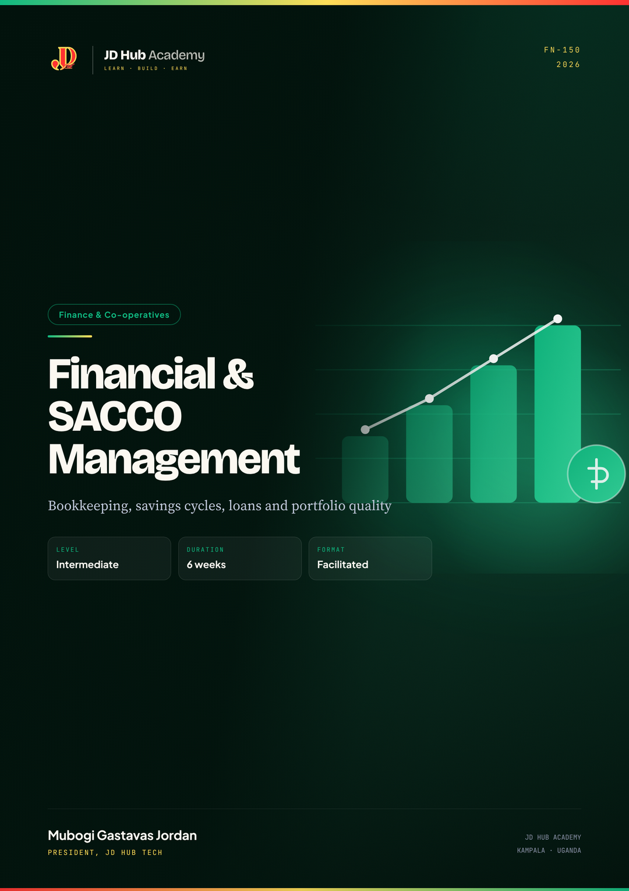

# Financial & SACCO Management

> Bookkeeping, savings cycles, loans and portfolio quality

**Course code:** FN-150 &nbsp;·&nbsp; **Level:** Intermediate
&nbsp;·&nbsp; **Duration:** 6 weeks · 12 sessions · 24 contact hours
&nbsp;·&nbsp; **Book:** 20 pages

**Author:** Mubogi Gastavas Jordan, President, JD Hub Tech · JD Hub Academy

---

## What this course is

How money actually moves through a SACCO or small business, and how to keep records that survive an audit. Double-entry bookkeeping, savings and loan cycles, arrears management, and the reports a board actually reads — with the JD Hub SACCO system used throughout.

**Who it is for:** SACCO staff and board members, treasurers, SME owners.

**Prerequisites:** Basic numeracy and spreadsheet familiarity.

**Next step:** Microsoft Excel, for financial modelling

---

## What you will be able to do

- Record transactions using double-entry bookkeeping
- Run a savings and loan cycle from opening to closing
- Calculate and interpret portfolio quality indicators
- Manage arrears before they become losses
- Prepare monthly reports a board can act on
- Apply the regulatory basics for Ugandan SACCOs

---

## Contents

- **Module 1 — How Money Moves Through a SACCO**
  - Lesson 1.1 — The cycle
  - Lesson 1.2 — The four types of money in a SACCO
  - Lesson 1.3 — Why SACCOs exist
- **Module 2 — Double-Entry Bookkeeping**
  - Lesson 2.1 — The one idea
  - Lesson 2.2 — Debits and credits without the confusion
  - Lesson 2.3 — The five account types
  - Lesson 2.4 — The books every SACCO needs
- **Module 3 — The Savings Cycle**
  - Lesson 3.1 — Why savings discipline is the whole foundation
  - Lesson 3.2 — Products that work
  - Lesson 3.3 — The withdrawal policy
- **Module 4 — The Loan Cycle**
  - Lesson 4.1 — The five stages
  - Lesson 4.2 — Appraisal that actually works
  - Lesson 4.3 — The loan policy document
- **Module 5 — Portfolio Quality**
  - Lesson 5.1 — The numbers that matter
  - Lesson 5.2 — Ageing
  - Lesson 5.3 — The collection discipline
- **Module 6 — Reporting to the Board**
  - Lesson 6.1 — What a board actually needs
  - Lesson 6.2 — The one-page dashboard
  - Lesson 6.3 — The questions a board should ask
- **Module 7 — Regulation and Governance**
  - Lesson 7.1 — Why governance is not optional
  - Lesson 7.2 — The regulatory basics in Uganda
  - Lesson 7.3 — The audit that protects you
- **Module 8 — Using the JD Hub SACCO System**
  - Lesson 8.1 — What it does
  - Lesson 8.2 — Daily discipline
  - Lesson 8.3 — Month-end
- **Module 9 — Capstone**
  - Lesson 9.1 — The brief
  - Lesson 9.2 — The rubric

---

## The book

- [Download the PDF](../../build/FN-150-financial-sacco.pdf) — complete course book, print-ready
- [Cover image](../../assets/covers/financial-sacco.png)
- [Wide banner](../../assets/covers/financial-sacco-wide.png)
- [Concept illustration](../../assets/illustrations/financial-sacco.png)

---

## Assessment

Every course in this library is assessed against a published rubric, printed in
the final module of the book. The pass mark is 60 percent, and the practical
component is mandatory regardless of total score.

The certificate states the learner's name, the course title, contact hours, tools
covered, the capstone title, and the date.

---

Copyright © 2026 Mubogi Gastavas Jordan, President, JD Hub Tech. All rights reserved.
See [LICENSE](../../LICENSE).
