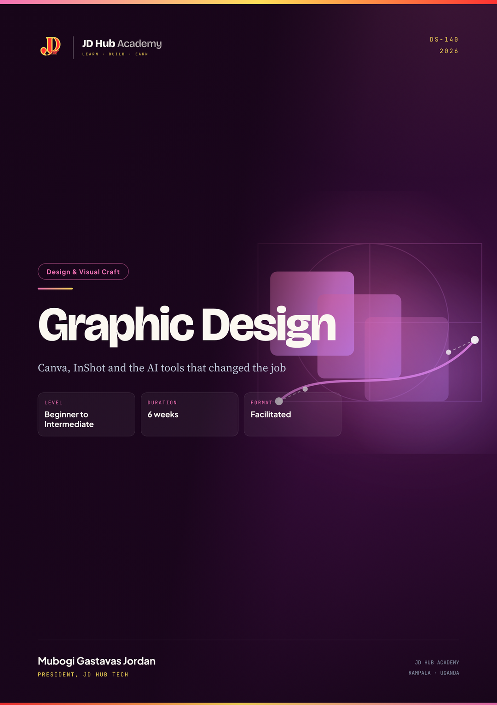

# Graphic Design

> Canva, InShot and the AI tools that changed the job

**Course code:** DS-140 &nbsp;·&nbsp; **Level:** Beginner to Intermediate
&nbsp;·&nbsp; **Duration:** 6 weeks · 12 sessions · 24 contact hours
&nbsp;·&nbsp; **Book:** 19 pages

**Author:** Mubogi Gastavas Jordan, President, JD Hub Tech · JD Hub Academy

---

## What this course is

Design that earns money. Brand identity, typography, colour, posters, social graphics, and short-form video — taught on Canva and InShot, with the current AI generation and editing tools built in. Ends with a portfolio and a price list.

**Who it is for:** Aspiring freelancers, church and NGO media teams, shop owners.

**Prerequisites:** Basic phone or computer use.

**Next step:** AI-201, for AI-assisted content at scale

---

## What you will be able to do

- Apply hierarchy, contrast, alignment and the three-colour rule
- Build a brand kit: logo, palette, type, templates
- Design print-ready posters and social graphics
- Edit short-form video with captions and transitions
- Use AI generation and background removal without breaking the brand
- Price and quote design work confidently

---

## Contents

- **Module 1 — What Design Actually Does**
  - Lesson 1.1 — The four principles
  - Lesson 1.2 — Why amateur design looks amateur
  - Lesson 1.3 — The three-metre test
- **Module 2 — Colour That Works**
  - Lesson 2.1 — The three-colour rule
  - Lesson 2.2 — What colours do
  - Lesson 2.3 — Contrast and accessibility
- **Module 3 — Typography**
  - Lesson 3.1 — Two fonts, maximum
  - Lesson 3.2 — Size and hierarchy
  - Lesson 3.3 — Spacing
- **Module 4 — Canva: The Working Method**
  - Lesson 4.1 — Templates, correctly used
  - Lesson 4.2 — The Brand Kit
  - Lesson 4.3 — Magic Resize
  - Lesson 4.4 — Export
- **Module 5 — InShot: Short-Form Video**
  - Lesson 5.1 — Why video matters commercially
  - Lesson 5.2 — The InShot workflow
  - Lesson 5.3 — The three-second rule
  - Lesson 5.4 — Captions
- **Module 6 — AI in Design**
  - Lesson 6.1 — What has genuinely changed
  - Lesson 6.2 — What has not changed
  - Lesson 6.3 — The honesty rules
  - Lesson 6.4 — The rejection habit
- **Module 7 — Pricing and Selling Design Work**
  - Lesson 7.1 — What to charge
  - Lesson 7.2 — The scope conversation
  - Lesson 7.3 — The portfolio
- **Module 8 — Capstone: A Full Brand Set**
  - Lesson 8.1 — The brief
  - Lesson 8.2 — The rubric

---

## The book

- [Download the PDF](../../build/DS-140-graphic-design.pdf) — complete course book, print-ready
- [Cover image](../../assets/covers/graphic-design.png)
- [Wide banner](../../assets/covers/graphic-design-wide.png)
- [Concept illustration](../../assets/illustrations/graphic-design.png)

---

## Assessment

Every course in this library is assessed against a published rubric, printed in
the final module of the book. The pass mark is 60 percent, and the practical
component is mandatory regardless of total score.

The certificate states the learner's name, the course title, contact hours, tools
covered, the capstone title, and the date.

---

Copyright © 2026 Mubogi Gastavas Jordan, President, JD Hub Tech. All rights reserved.
See [LICENSE](../../LICENSE).
