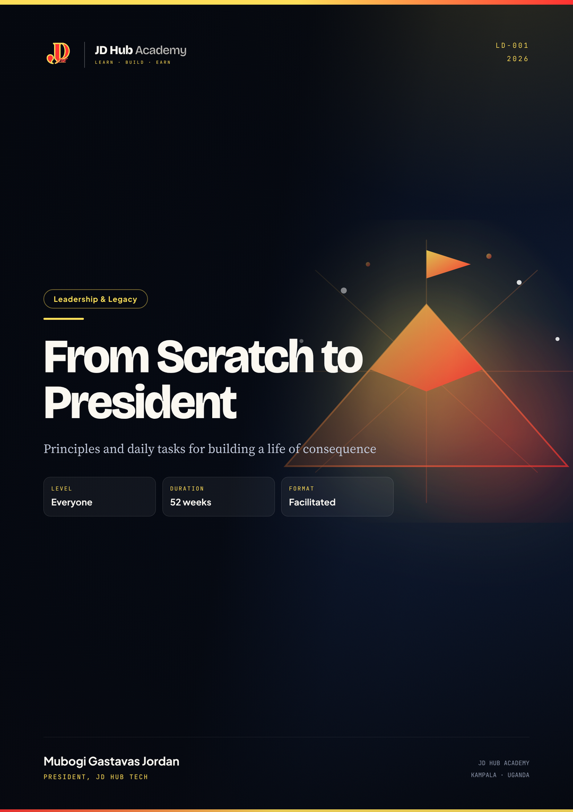

# From Scratch to President

> Principles and daily tasks for building a life of consequence

**Course code:** LD-001 &nbsp;·&nbsp; **Level:** Everyone — the book to read first and re-read every year
&nbsp;·&nbsp; **Duration:** 52 weeks · one principle and one task per week
&nbsp;·&nbsp; **Book:** 70 pages

**Author:** Mubogi Gastavas Jordan, President, JD Hub Tech · JD Hub Academy

---

## What this course is

A year-long manual for building something from nothing. Fifty-two weekly principles, each with a task you can complete in a day, drawn from the actual work of building businesses, systems and institutions. Not motivation. Mechanics, with Scripture as the foundation.

**Who it is for:** Founders, students, pastors, civil servants, tradespeople, parents.

**Prerequisites:** Honesty about where you currently are.

**Next step:** Business Growth & Sales Systems, then AI-201

---

## What you will be able to do

- Build the habits that precede any result worth having
- Price your work, your time and your standards
- Build systems that run without your presence
- Lead people without manipulating them
- Handle money, debt and growth without losing the business
- Make decisions under uncertainty and live with them
- Leave something that outlives your involvement

---

## Contents

- **Preface — Why This Book Exists**
  - How to use this book
  - A word about money
- **Part One — The Foundation**
- **Week 1 — Start Where You Are**
  - The principle
  - The task
- **Week 2 — The Honest Ledger**
  - The principle
  - The task
- **Week 3 — The Discipline of Small**
  - The principle
  - The task
- **Week 4 — Time Is the Only Inventory**
  - The principle
  - The task
- **Week 5 — Skill Before Scale**
  - The principle
  - The task
- **Week 6 — The Reputation Ledger**
  - The principle
  - The task
- **Week 7 — Say No to Good Things**
  - The principle
  - The task
- **Week 8 — The First Hundred Days**
  - The principle
  - The task
- **Part Two — Money**
- **Week 9 — Price Your Work Properly**
  - The principle
  - The task
- **Week 10 — Cash Is Not Profit**
  - The principle
  - The task
- **Week 11 — Debt: The Tool and the Trap**
  - The principle
  - The task
- **Week 12 — Build a Buffer**
  - The principle
  - The task
- **Week 13 — The Reinvestment Rule**
  - The principle
  - The task
- **Week 14 — Know Your Break-Even**
  - The principle
  - The task
- **Week 15 — Separate the Money**
  - The principle
  - The task
- **Week 16 — Read Your Own Numbers**
  - The principle
  - The task
- **Part Three — Systems**
- **Week 17 — Document What You Do**
  - The principle
  - The task
- **Week 18 — Build the Machine, Not the Heroics**
  - The principle
  - The task
- **Week 19 — Checklists Beat Memory**
  - The principle
  - The task
- **Week 20 — Measure What Matters**
  - The principle
  - The task
- **Week 21 — Delegate, Do Not Abandon**
  - The principle
  - The task
- **Week 22 — Hire for Character, Train for Skill**
  - The principle
  - The task
- **Week 23 — Fire Quickly, Kindly, Legally**
  - The principle
  - The task
- **Week 24 — Build the Second Line**
  - The principle
  - The task
- **Part Four — People**
- **Week 25 — Authority Is Borrowed**
  - The principle
  - The task
- **Week 26 — Say the Difficult Thing**
  - The principle
  - The task
- **Week 27 — Pay People Properly**
  - The principle
  - The task
- **Week 28 — Build Trust With Consistency**
  - The principle
  - The task
- **Week 29 — Handle Failure Without Blame**
  - The principle
  - The task
- **Week 30 — Mentor Someone**
  - The principle
  - The task
- **Week 31 — Build a Table, Not a Throne**
  - The principle
  - The task
- **Week 32 — Succession Is Not Betrayal**
  - The principle
  - The task
- **Part Five — The Long Game**
- **Week 33 — Compounding Is the Only Magic**
  - The principle
  - The task
- **Week 34 — Adversity Is Curriculum**
  - The principle
  - The task
- **Week 35 — Guard Your Body**
  - The principle
  - The task
- **Week 36 — Guard Your Mind**
  - The principle
  - The task
- **Week 37 — Keep Your Word to Yourself**
  - The principle
  - The task
- **Week 38 — Learn From People Who Disagree**
  - The principle
  - The task
- **Week 39 — Do the Boring Things First**
  - The principle
  - The task
- **Week 40 — Build the Year, Not the Day**
  - The principle
  - The task
- **Week 41 — Say Thank You**
  - The principle
  - The task
- **Week 42 — Rest Is a Strategy**
  - The principle
  - The task
- **Week 43 — Teach It to Keep It**
  - The principle
  - The task
- **Week 44 — Give It Away**
  - The principle
  - The task
- **Part Six — Legacy**
- **Week 45 — Decide What You Are For**
  - The principle
  - The task
- **Week 46 — Build Institutions, Not Empires**
  - The principle
  - The task
- **Week 47 — Guard Your Integrity in Small Things**
  - The principle
  - The task
- **Week 48 — Prepare the Next Generation**
  - The principle
  - The task
- **Week 49 — Choose Your Successor Before You Need To**
  - The principle
  - The task
- **Week 50 — Measure Your Life, Not Just Your Business**
  - The principle
  - The task
- **Week 51 — Finish Well**
  - The principle
  - The task
- **Week 52 — Begin Again**
  - The principle
  - The task
- **Afterword — The Position**

---

## The book

- [Download the PDF](../../build/LD-001-leadership.pdf) — complete course book, print-ready
- [Cover image](../../assets/covers/leadership.png)
- [Wide banner](../../assets/covers/leadership-wide.png)
- [Concept illustration](../../assets/illustrations/leadership.png)

---

## Assessment

Every course in this library is assessed against a published rubric, printed in
the final module of the book. The pass mark is 60 percent, and the practical
component is mandatory regardless of total score.

The certificate states the learner's name, the course title, contact hours, tools
covered, the capstone title, and the date.

---

Copyright © 2026 Mubogi Gastavas Jordan, President, JD Hub Tech. All rights reserved.
See [LICENSE](../../LICENSE).
