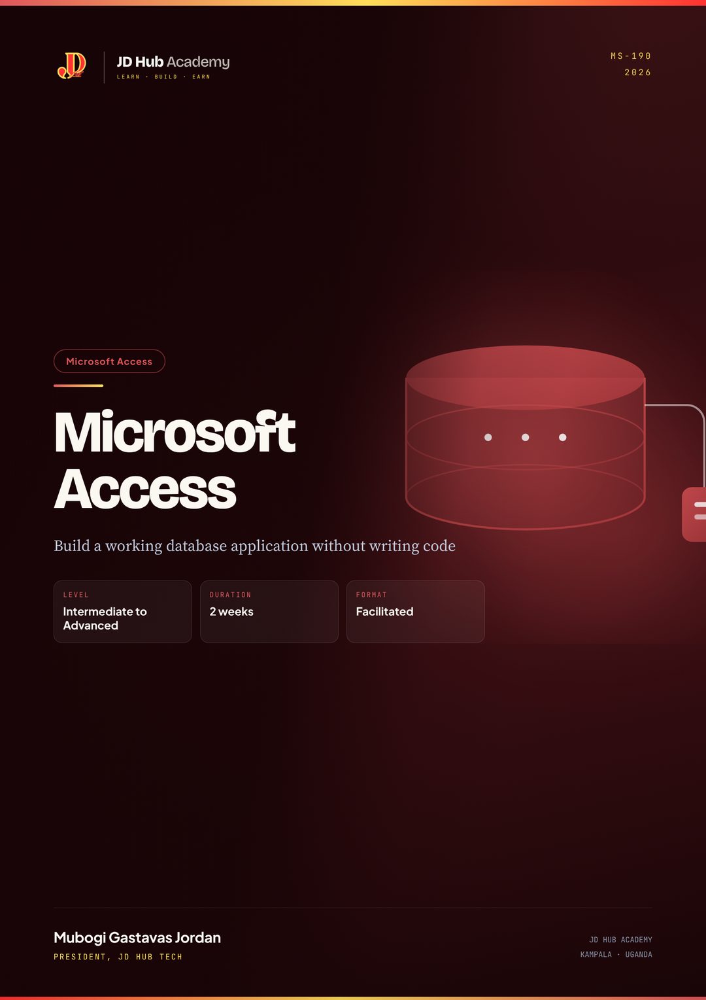

# Microsoft Access

> Build a working database application without writing code

**Course code:** MS-190 &nbsp;·&nbsp; **Level:** Intermediate to Advanced
&nbsp;·&nbsp; **Duration:** 2 weeks · 8 sessions · 12 contact hours
&nbsp;·&nbsp; **Book:** 18 pages

**Author:** Mubogi Gastavas Jordan, President, JD Hub Tech · JD Hub Academy

---

## What this course is

When Excel stops coping. Table design, relationships, queries, forms and reports — ending with a small working application for members, stock or clients, complete with a navigation menu.

**Who it is for:** Records officers, registrars, stock controllers, clinic staff.

**Prerequisites:** Microsoft Excel, or equivalent comfort with data.

**Next step:** AI-201, for querying data in plain language

---

## What you will be able to do

- Normalise data and design tables properly
- Build relationships with referential integrity
- Write select, parameter and action queries
- Build data-entry forms with validation
- Produce grouped reports and print layouts
- Assemble a navigation system with macros

---

## Contents

- **Module 1 — When Excel Stops Coping**
  - Lesson 1.1 — The signals that you need a database
  - Lesson 1.2 — What a relational database is
  - Lesson 1.3 — The four objects in Access
- **Module 2 — Table Design**
  - Lesson 2.1 — One table, one subject
  - Lesson 2.2 — Field types
  - Lesson 2.3 — The rules that prevent pain
  - Lesson 2.4 — Normalisation, in plain language
- **Module 3 — Relationships**
  - Lesson 3.1 — Why relationships matter
  - Lesson 3.2 — The three relationship types
  - Lesson 3.3 — Referential integrity
- **Module 4 — Queries**
  - Lesson 4.1 — The query designer
  - Lesson 4.2 — The four kinds
  - Lesson 4.3 — Criteria
  - Lesson 4.4 — Totals queries
  - Lesson 4.5 — Calculated fields
- **Module 5 — Forms**
  - Lesson 5.1 — Why forms
  - Lesson 5.2 — The form wizard
  - Lesson 5.3 — Subforms
  - Lesson 5.4 — Comboboxes and validation
- **Module 6 — Reports**
  - Lesson 6.1 — Why reports are separate from queries
  - Lesson 6.2 — The report wizard
  - Lesson 6.3 — Grouping and totals
  - Lesson 6.4 — The reports a small organisation needs
- **Module 7 — Macros and Navigation**
  - Lesson 7.1 — Macros without code
  - Lesson 7.2 — The navigation form
  - Lesson 7.3 — The startup settings
- **Module 8 — Compacting, Backing Up, Sharing**
  - Lesson 8.1 — Compact and repair
  - Lesson 8.2 — Backing up
  - Lesson 8.3 — Sharing, and the limits
- **Module 9 — Capstone**
  - Lesson 9.1 — The brief
  - Lesson 9.2 — The rubric

---

## The book

- [Download the PDF](../../build/MS-190-microsoft-access.pdf) — complete course book, print-ready
- [Cover image](../../assets/covers/microsoft-access.png)
- [Wide banner](../../assets/covers/microsoft-access-wide.png)
- [Concept illustration](../../assets/illustrations/microsoft-access.png)

---

## Assessment

Every course in this library is assessed against a published rubric, printed in
the final module of the book. The pass mark is 60 percent, and the practical
component is mandatory regardless of total score.

The certificate states the learner's name, the course title, contact hours, tools
covered, the capstone title, and the date.

---

Copyright © 2026 Mubogi Gastavas Jordan, President, JD Hub Tech. All rights reserved.
See [LICENSE](../../LICENSE).
