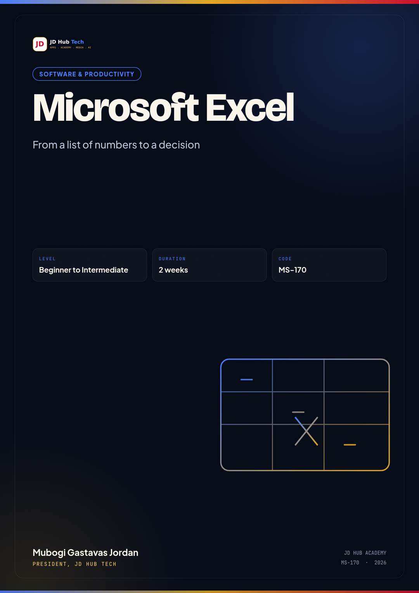

# Microsoft Excel

> From a list of numbers to a decision

**Course code:** MS-170 &nbsp;·&nbsp; **Level:** Beginner to Intermediate
&nbsp;·&nbsp; **Duration:** 2 weeks · 8 sessions · 12 contact hours
&nbsp;·&nbsp; **Book:** 18 pages

**Author:** Mubogi Gastavas Jordan, President, JD Hub Tech · JD Hub Academy

---

## What this course is

Formulas that work, lookups that do not break, pivot tables that answer questions, and dashboards someone else can read. Includes the AI features now built into Excel and Sheets.

**Who it is for:** Administrators, accountants, shop owners, researchers.

**Prerequisites:** Basic computer use. No maths beyond arithmetic.

**Next step:** Microsoft Access, or Financial & SACCO Management

---

## What you will be able to do

- Write formulas with confidence and debug them methodically
- Use VLOOKUP/XLOOKUP, INDEX-MATCH and conditional logic
- Clean messy data and remove duplicates safely
- Build pivot tables and a one-page dashboard
- Apply conditional formatting that highlights what matters
- Automate a recurring report

---

## Contents

- **Module 1 — The Grid, and Why It Matters**
  - Lesson 1.1 — The interface
  - Lesson 1.2 — Data types
  - Lesson 1.3 — Good habits from day one
- **Module 2 — Formulas That Work**
  - Lesson 2.1 — The four operators
  - Lesson 2.2 — The functions you will actually use
  - Lesson 2.3 — Absolute and relative references
  - Lesson 2.4 — Debugging formulas
- **Module 3 — Lookups**
  - Lesson 3.1 — What a lookup does
  - Lesson 3.2 — VLOOKUP and XLOOKUP
  - Lesson 3.3 — INDEX and MATCH
- **Module 4 — Cleaning Messy Data**
  - Lesson 4.1 — The five common problems
  - Lesson 4.2 — The cleaning toolkit
  - Lesson 4.3 — The safe workflow
- **Module 5 — Pivot Tables**
  - Lesson 5.1 — What a pivot table is for
  - Lesson 5.2 — Building one
  - Lesson 5.3 — The settings that matter
  - Lesson 5.4 — The one-page dashboard
- **Module 6 — Charts That Say Something**
  - Lesson 6.1 — Which chart for which question
  - Lesson 6.2 — Chart discipline
- **Module 7 — Automating Recurring Work**
  - Lesson 7.1 — What to automate
  - Lesson 7.2 — The tools
  - Lesson 7.3 — The monthly report that builds itself
- **Module 8 — AI in Excel**
  - Lesson 8.1 — What it does well
  - Lesson 8.2 — What it does badly
  - Lesson 8.3 — The safe pattern
- **Module 9 — Capstone**
  - Lesson 9.1 — The brief
  - Lesson 9.2 — The rubric

---

## The book

- [Download the PDF](../../build/MS-170-microsoft-excel.pdf) — complete course book, print-ready
- [Cover image](../../assets/covers/microsoft-excel.png)
- [Wide banner](../../assets/covers/microsoft-excel-wide.png)
- [Concept illustration](../../assets/illustrations/microsoft-excel.png)

---

## Assessment

Every course in this library is assessed against a published rubric, printed in
the final module of the book. The pass mark is 60 percent, and the practical
component is mandatory regardless of total score.

The certificate states the learner's name, the course title, contact hours, tools
covered, the capstone title, and the date.

---

Copyright © 2026 Mubogi Gastavas Jordan, President, JD Hub Tech. All rights reserved.
See [LICENSE](../../LICENSE).
