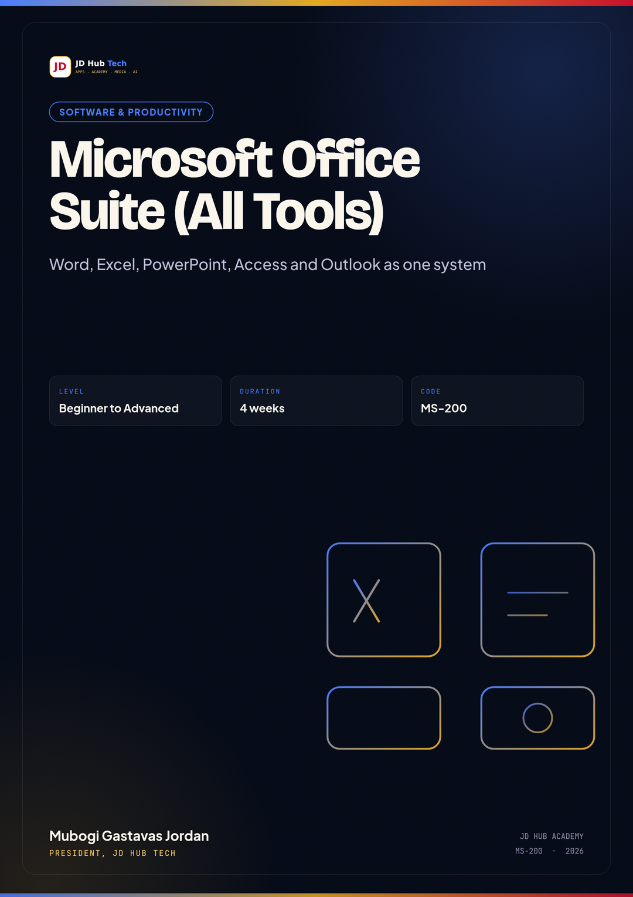

# Microsoft Office Suite (All Tools)

> Word, Excel, PowerPoint, Access and Outlook as one system

**Course code:** MS-200 &nbsp;·&nbsp; **Level:** Beginner to Advanced
&nbsp;·&nbsp; **Duration:** 4 weeks · 16 sessions · 24 contact hours
&nbsp;·&nbsp; **Book:** 16 pages

**Author:** Mubogi Gastavas Jordan, President, JD Hub Tech · JD Hub Academy

---

## What this course is

The complete office productivity programme. Each tool to working competence, then the part nobody teaches: making them work together, with a capstone project that uses all five.

**Who it is for:** Job seekers, office staff, administrators, graduates.

**Prerequisites:** Basic computer use.

**Next step:** AI-101, to add AI to the workflow

---

## What you will be able to do

- Produce professional documents, spreadsheets and presentations
- Design a small database and report from it
- Manage email, calendar and contacts in Outlook
- Link tools: Excel to Word, Access to Excel, data to slides
- Deliver a capstone project spanning the suite
- Sit an employer-recognised practical assessment

---

## Contents

- **Module 1 — The Suite as One System**
  - Lesson 1.1 — What each tool is for
  - Lesson 1.2 — The integration map
  - Lesson 1.3 — The capstone you are building toward
- **Module 2 — Word to Working Competence**
  - Lesson 2.1 — Styles first
  - Lesson 2.2 — The professional document
  - Lesson 2.3 — Tables, images and captions
  - Lesson 2.4 — Mail merge
- **Module 3 — Excel to Working Competence**
  - Lesson 3.1 — The twenty formulas that cover most work
  - Lesson 3.2 — Structure
  - Lesson 3.3 — Analysis
  - Lesson 3.4 — The monthly report that builds itself
- **Module 4 — PowerPoint to Working Competence**
  - Lesson 4.1 — The master
  - Lesson 4.2 — Restraint
  - Lesson 4.3 — Charts in slides
  - Lesson 4.4 — Delivery
- **Module 5 — Access to Working Competence**
  - Lesson 5.1 — When to use it
  - Lesson 5.2 — The minimum viable database
  - Lesson 5.3 — The rules
- **Module 6 — Outlook to Working Competence**
  - Lesson 6.1 — Email that gets answered
  - Lesson 6.2 — Folders and rules
  - Lesson 6.3 — Calendar discipline
  - Lesson 6.4 — Contacts and groups
- **Module 7 — Integration: Where the Value Is**
  - Lesson 7.1 — Excel to Word
  - Lesson 7.2 — Excel to PowerPoint
  - Lesson 7.3 — Excel to Word mail merge
  - Lesson 7.4 — Access to Excel
  - Lesson 7.5 — The complete workflow
- **Module 8 — AI Across the Suite**
  - Lesson 8.1 — Where it helps in each tool
  - Lesson 8.2 — The rule that applies everywhere
  - Lesson 8.3 — The safe pattern
- **Module 9 — Capstone: The Complete Package**
  - Lesson 9.1 — The brief
  - Lesson 9.2 — The rubric

---

## The book

- [Download the PDF](../../build/MS-200-microsoft-office-suite.pdf) — complete course book, print-ready
- [Cover image](../../assets/covers/microsoft-office-suite.png)
- [Wide banner](../../assets/covers/microsoft-office-suite-wide.png)
- [Concept illustration](../../assets/illustrations/microsoft-office-suite.png)

---

## Assessment

Every course in this library is assessed against a published rubric, printed in
the final module of the book. The pass mark is 60 percent, and the practical
component is mandatory regardless of total score.

The certificate states the learner's name, the course title, contact hours, tools
covered, the capstone title, and the date.

---

Copyright © 2026 Mubogi Gastavas Jordan, President, JD Hub Tech. All rights reserved.
See [LICENSE](../../LICENSE).
