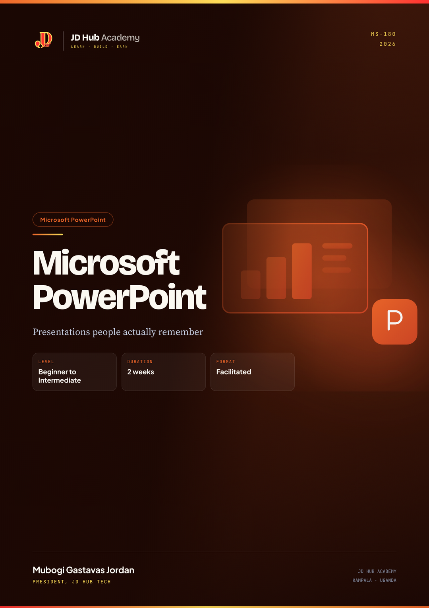

# Microsoft PowerPoint

> Presentations people actually remember

**Course code:** MS-180 &nbsp;·&nbsp; **Level:** Beginner to Intermediate
&nbsp;·&nbsp; **Duration:** 2 weeks · 8 sessions · 12 contact hours
&nbsp;·&nbsp; **Book:** 18 pages

**Author:** Mubogi Gastavas Jordan, President, JD Hub Tech · JD Hub Academy

---

## What this course is

Design, structure and delivery. Slide masters, restraint in animation, charts that make one point, and the rehearsal habits that separate a confident presenter from a nervous one.

**Who it is for:** Students, teachers, business presenters, church leaders.

**Prerequisites:** Basic computer use.

**Next step:** Graphic Design, for visual polish

---

## What you will be able to do

- Build a slide master and a reusable template
- Structure a presentation around one argument
- Design charts that make a single point legible
- Use animation and transitions without embarrassing yourself
- Rehearse with presenter tools and timing
- Export to video and PDF for distribution

---

## Contents

- **Module 1 — Why Presentations Fail**
  - Lesson 1.1 — The one-sentence rule
  - Lesson 1.2 — Slides support a speaker
  - Lesson 1.3 — The structure that always works
- **Module 2 — Slide Masters and Themes**
  - Lesson 2.1 — Why masters matter
  - Lesson 2.2 — Setting up the master
  - Lesson 2.3 — The theme colours
  - Lesson 2.4 — Layouts
- **Module 3 — Text, Hierarchy and Restraint**
  - Lesson 3.1 — The six-by-six guideline
  - Lesson 3.2 — Titles that state a finding
  - Lesson 3.3 — Visual hierarchy
  - Lesson 3.4 — White space
- **Module 4 — Images, Icons and Shapes**
  - Lesson 4.1 — Images that earn their place
  - Lesson 4.2 — Icons
  - Lesson 4.3 — Shapes as structure
- **Module 5 — Charts and Data**
  - Lesson 5.1 — One point per chart
  - Lesson 5.2 — The settings that matter
  - Lesson 5.3 — Animation for data
- **Module 6 — Animation and Transitions**
  - Lesson 6.1 — Transitions
  - Lesson 6.2 — Animation, used well
  - Lesson 6.3 — The animation settings
- **Module 7 — Presenter Tools and Rehearsal**
  - Lesson 7.1 — Presenter View
  - Lesson 7.2 — Rehearse with timing
  - Lesson 7.3 — Notes that help
  - Lesson 7.4 — The delivery habits
- **Module 8 — Exporting and Sharing**
  - Lesson 8.1 — The formats
  - Lesson 8.2 — The handout
  - Lesson 8.3 — Fonts and portability
- **Module 9 — AI-Assisted Slide Production**
  - Lesson 9.1 — What works
  - Lesson 9.2 — What fails
  - Lesson 9.3 — The workflow
- **Module 10 — Capstone**
  - Lesson 10.1 — The brief
  - Lesson 10.2 — The rubric

---

## The book

- [Download the PDF](../../build/MS-180-microsoft-powerpoint.pdf) — complete course book, print-ready
- [Cover image](../../assets/covers/microsoft-powerpoint.png)
- [Wide banner](../../assets/covers/microsoft-powerpoint-wide.png)
- [Concept illustration](../../assets/illustrations/microsoft-powerpoint.png)

---

## Assessment

Every course in this library is assessed against a published rubric, printed in
the final module of the book. The pass mark is 60 percent, and the practical
component is mandatory regardless of total score.

The certificate states the learner's name, the course title, contact hours, tools
covered, the capstone title, and the date.

---

Copyright © 2026 Mubogi Gastavas Jordan, President, JD Hub Tech. All rights reserved.
See [LICENSE](../../LICENSE).
