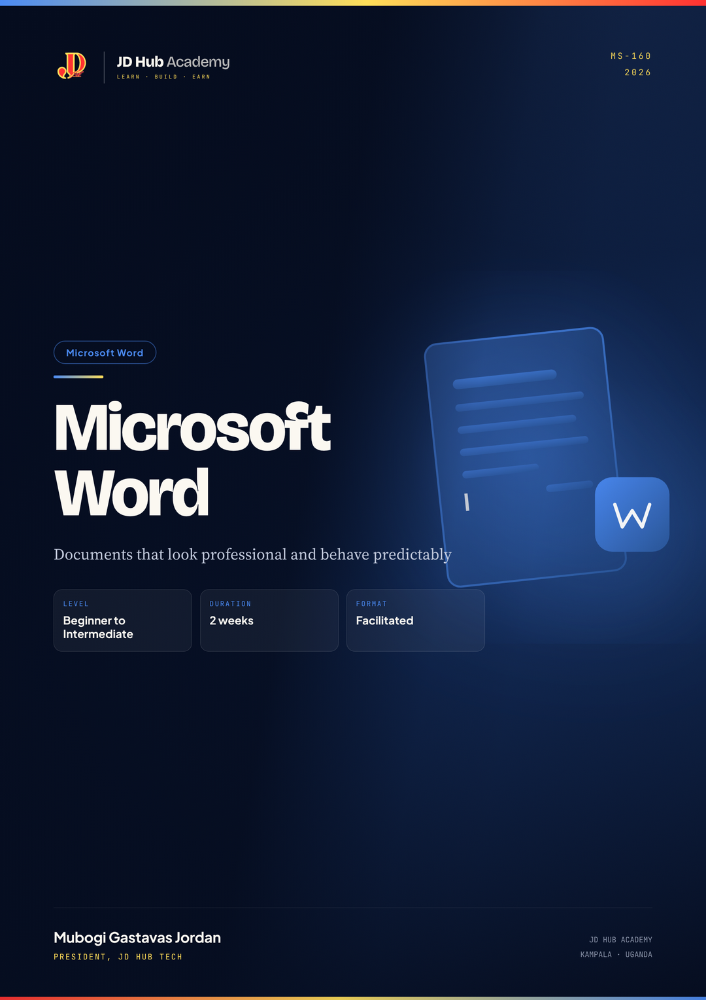

# Microsoft Word

> Documents that look professional and behave predictably

**Course code:** MS-160 &nbsp;·&nbsp; **Level:** Beginner to Intermediate
&nbsp;·&nbsp; **Duration:** 2 weeks · 8 sessions · 12 contact hours
&nbsp;·&nbsp; **Book:** 17 pages

**Author:** Mubogi Gastavas Jordan, President, JD Hub Tech · JD Hub Academy

---

## What this course is

Most people use ten percent of Word and fight the other ninety. This course fixes that: styles, sections, tables, mail merge, and long documents that do not fall apart when you add a page.

**Who it is for:** Office staff, administrators, students, teachers, job seekers.

**Prerequisites:** Basic typing and file handling.

**Next step:** Microsoft Excel

---

## What you will be able to do

- Apply styles so formatting is consistent and changeable in one click
- Build tables, columns and multi-section layouts
- Use mail merge for letters, certificates and labels
- Create an automatic table of contents and page numbering
- Track changes and review a document collaboratively
- Produce a print-ready report, CV and certificate

---

## Contents

- **Module 1 — Why Most People Use Word Badly**
  - Lesson 1.1 — The interface, in five minutes
  - Lesson 1.2 — The ten shortcuts that halve your time
  - Lesson 1.3 — The document you will build
- **Module 2 — Styles: The Thing That Changes Everything**
  - Lesson 2.1 — What a style is
  - Lesson 2.2 — The five styles you need
  - Lesson 2.3 — Modifying a style
  - Lesson 2.4 — Why this saves hours
- **Module 3 — Layout, Sections and Page Control**
  - Lesson 3.1 — Margins and page setup
  - Lesson 3.2 — Sections
  - Lesson 3.3 — Headers, footers and page numbers
  - Lesson 3.4 — Columns and text boxes
- **Module 4 — Tables and Images**
  - Lesson 4.1 — Tables that behave
  - Lesson 4.2 — Images without chaos
  - Lesson 4.3 — Captions and cross-references
- **Module 5 — Mail Merge**
  - Lesson 5.1 — What mail merge does
  - Lesson 5.2 — The three-step method
  - Lesson 5.3 — Preview and finish
  - Lesson 5.4 — The certificate use case
- **Module 6 — Long Documents**
  - Lesson 6.1 — The table of contents
  - Lesson 6.2 — Numbering that does not break
  - Lesson 6.3 — Track changes and comments
  - Lesson 6.4 — Find and replace with wildcards
- **Module 7 — Printing and Sharing**
  - Lesson 7.1 — Print preview is not optional
  - Lesson 7.2 — Export to PDF
  - Lesson 7.3 — Protecting a document
- **Module 8 — Using AI Inside Word**
  - Lesson 8.1 — What Copilot does well
  - Lesson 8.2 — What it does badly
  - Lesson 8.3 — The practical workflow
- **Module 9 — Capstone**
  - Lesson 9.1 — The brief
  - Lesson 9.2 — The rubric

---

## The book

- [Download the PDF](../../build/MS-160-microsoft-word.pdf) — complete course book, print-ready
- [Cover image](../../assets/covers/microsoft-word.png)
- [Wide banner](../../assets/covers/microsoft-word-wide.png)
- [Concept illustration](../../assets/illustrations/microsoft-word.png)

---

## Assessment

Every course in this library is assessed against a published rubric, printed in
the final module of the book. The pass mark is 60 percent, and the practical
component is mandatory regardless of total score.

The certificate states the learner's name, the course title, contact hours, tools
covered, the capstone title, and the date.

---

Copyright © 2026 Mubogi Gastavas Jordan, President, JD Hub Tech. All rights reserved.
See [LICENSE](../../LICENSE).
