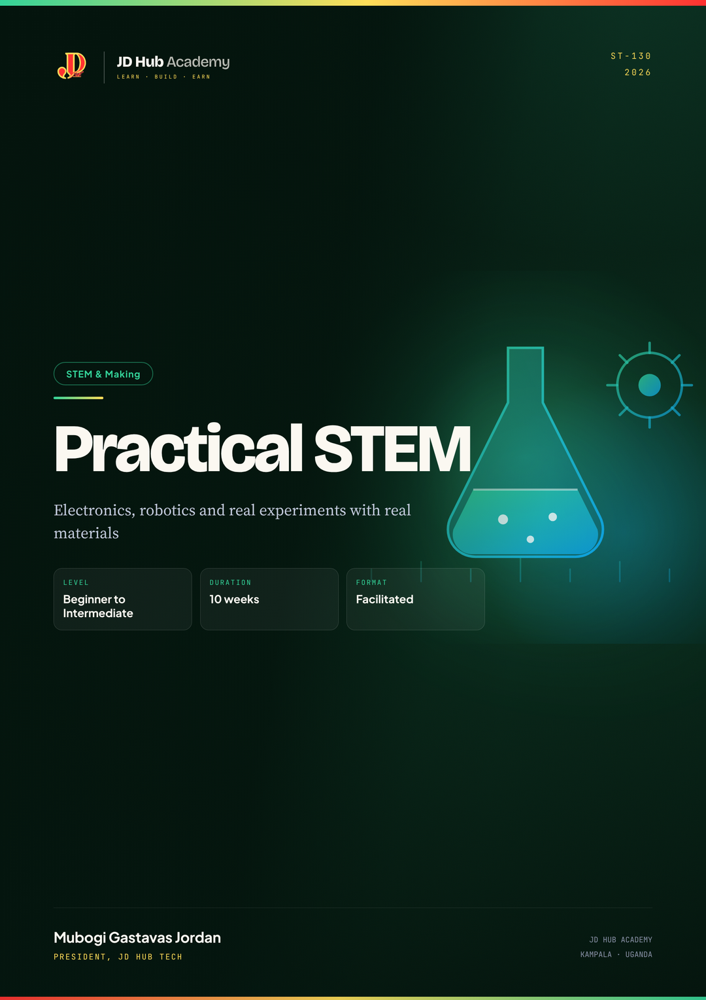

# Practical STEM

> Electronics, robotics and real experiments with real materials

**Course code:** ST-130 &nbsp;·&nbsp; **Level:** Beginner to Intermediate
&nbsp;·&nbsp; **Duration:** 10 weeks · 20 sessions · 30 contact hours
&nbsp;·&nbsp; **Book:** 17 pages

**Author:** Mubogi Gastavas Jordan, President, JD Hub Tech · JD Hub Academy

---

## What this course is

Science you can hold. Learners wire circuits, build a working robot from a block kit, and run inquiry experiments using cheap local materials — then model the results in a spreadsheet. Designed for schools without a laboratory budget.

**Who it is for:** Ages 10–18, teachers, and school science clubs.

**Prerequisites:** Basic numeracy. Curiosity required.

**Next step:** Scratch Coding, then electronics at AI-301 level

---

## What you will be able to do

- Apply the scientific method to a question you chose
- Build and fault-find series and parallel circuits
- Program a block-based robot to complete a task
- Collect, tabulate and graph real measurements
- Present findings as a scientific poster

---

## Contents

- **Module 1 — Science With What You Have**
  - Lesson 1.1 — The scientific method, plainly
  - Lesson 1.2 — Variables
  - Lesson 1.3 — Recording honestly
- **Module 2 — Electricity and Circuits**
  - Lesson 2.1 — What electricity is, practically
  - Lesson 2.2 — The series circuit
  - Lesson 2.3 — The parallel circuit
  - Lesson 2.4 — The materials list
- **Module 3 — Magnetism and Motors**
  - Lesson 3.1 — Magnets
  - Lesson 3.2 — Electromagnets
  - Lesson 3.3 — The simple motor
- **Module 4 — Measurement and Data**
  - Lesson 4.1 — Measuring properly
  - Lesson 4.2 — From table to graph
  - Lesson 4.3 — Interpreting honestly
- **Module 5 — Introductory Robotics**
  - Lesson 5.1 — A robot is three things
  - Lesson 5.2 — Block-based robot programming
  - Lesson 5.3 — The engineering habit
- **Module 6 — Maths Modelling With Real Data**
  - Lesson 6.1 — Why model
  - Lesson 6.2 — Building a simple model
  - Lesson 6.3 — When models fail
- **Module 7 — The Science Poster**
  - Lesson 7.1 — Structure
  - Lesson 7.2 — Design that communicates
  - Lesson 7.3 — Presenting
- **Module 8 — Capstone: An Independent Investigation**
  - Lesson 8.1 — The brief
  - Lesson 8.2 — The rubric

---

## The book

- [Download the PDF](../../build/ST-130-practical-stem.pdf) — complete course book, print-ready
- [Cover image](../../assets/covers/practical-stem.png)
- [Wide banner](../../assets/covers/practical-stem-wide.png)
- [Concept illustration](../../assets/illustrations/practical-stem.png)

---

## Assessment

Every course in this library is assessed against a published rubric, printed in
the final module of the book. The pass mark is 60 percent, and the practical
component is mandatory regardless of total score.

The certificate states the learner's name, the course title, contact hours, tools
covered, the capstone title, and the date.

---

Copyright © 2026 Mubogi Gastavas Jordan, President, JD Hub Tech. All rights reserved.
See [LICENSE](../../LICENSE).
