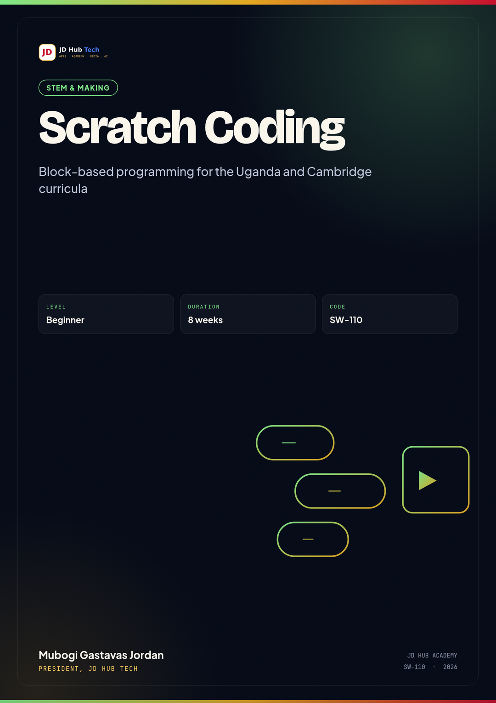

# Scratch Coding

> Block-based programming for the Uganda and Cambridge curricula

**Course code:** SW-110 &nbsp;·&nbsp; **Level:** Beginner — ages 8 and up
&nbsp;·&nbsp; **Duration:** 8 weeks · 16 sessions · 24 contact hours
&nbsp;·&nbsp; **Book:** 15 pages

**Author:** Mubogi Gastavas Jordan, President, JD Hub Tech · JD Hub Academy

---

## What this course is

Children build animations, games and interactive stories while learning computational thinking. Every lesson maps to a named competency in the Uganda lower-secondary ICT syllabus and the Cambridge Primary/Secondary Computing framework, so parents can see the progress.

**Who it is for:** Children 8–16, and teachers who want to deliver the curriculum.

**Prerequisites:** Basic reading and mouse or touchscreen control.

**Next step:** Practical STEM, then Python foundations

---

## What you will be able to do

- Sequence, loop, and use events to control sprites
- Apply conditionals, variables and operators
- Design and debug a multi-level game
- Build an interactive story with broadcast messaging
- Present a finished project and explain the logic

---

## Contents

- **Module 1 — Thinking Like a Computer**
  - Lesson 1.1 — What a program is
  - Lesson 1.2 — The Scratch workspace
  - Lesson 1.3 — Your first program
- **Module 2 — Sequence and Loops**
  - Lesson 2.1 — Sequence
  - Lesson 2.2 — Loops
  - Lesson 2.3 — Nested loops
- **Module 3 — Variables and Conditionals**
  - Lesson 3.1 — Variables
  - Lesson 3.2 — Conditionals
  - Lesson 3.3 — The score system
- **Module 4 — Events, Broadcasts and Coordination**
  - Lesson 4.1 — Events
  - Lesson 4.2 — Broadcast
  - Lesson 4.3 — A conversation
- **Module 5 — Debugging: The Most Important Skill**
  - Lesson 5.1 — Bugs are normal
  - Lesson 5.2 — The four-step debugging method
  - Lesson 5.3 — Common beginner bugs
- **Module 6 — Curriculum Alignment**
  - Lesson 6.1 — Mapping to the Uganda syllabus
  - Lesson 6.2 — Mapping to Cambridge
  - Lesson 6.3 — For teachers: assessment evidence
- **Module 7 — The Final Project**
  - Lesson 7.1 — Choose a project
  - Lesson 7.2 — The build plan
- **Module 8 — Assessment and Presentation**
  - Lesson 8.1 — The rubric
  - Lesson 8.2 — The presentation
- **Module 9 — Where This Leads**

---

## The book

- [Download the PDF](../../build/SW-110-scratch-coding.pdf) — complete course book, print-ready
- [Cover image](../../assets/covers/scratch-coding.png)
- [Wide banner](../../assets/covers/scratch-coding-wide.png)
- [Concept illustration](../../assets/illustrations/scratch-coding.png)

---

## Assessment

Every course in this library is assessed against a published rubric, printed in
the final module of the book. The pass mark is 60 percent, and the practical
component is mandatory regardless of total score.

The certificate states the learner's name, the course title, contact hours, tools
covered, the capstone title, and the date.

---

Copyright © 2026 Mubogi Gastavas Jordan, President, JD Hub Tech. All rights reserved.
See [LICENSE](../../LICENSE).
