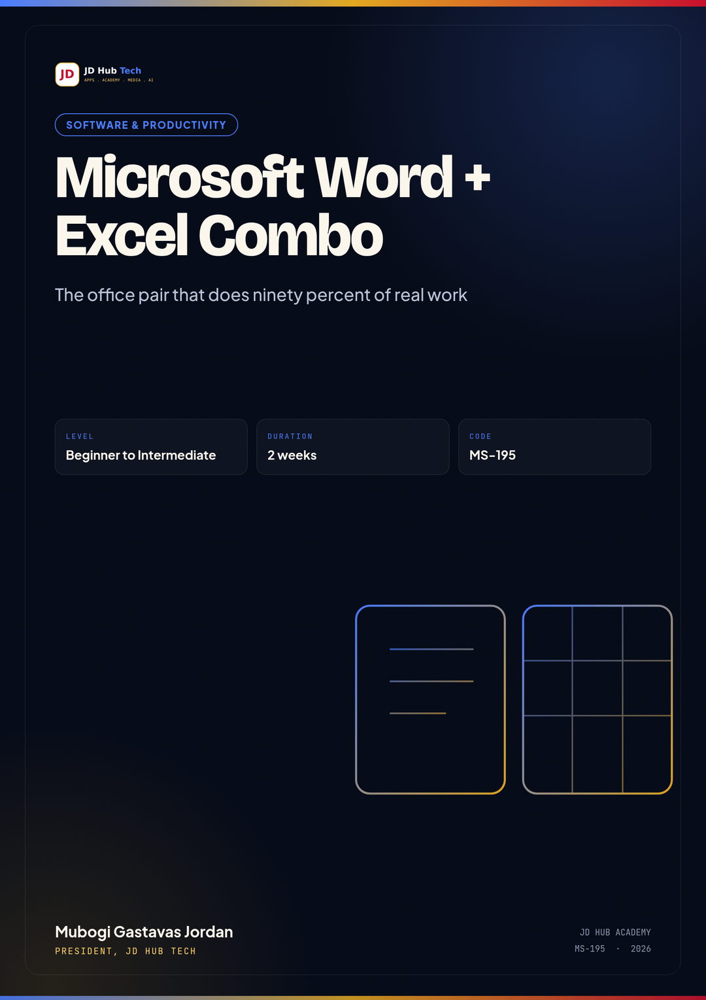

# Microsoft Word + Excel Combo

> The office pair that does ninety percent of real work

**Course code:** MS-195 &nbsp;·&nbsp; **Level:** Beginner to Intermediate
&nbsp;·&nbsp; **Duration:** 2 weeks · 8 sessions · 12 contact hours
&nbsp;·&nbsp; **Book:** 18 pages

**Author:** Mubogi Gastavas Jordan, President, JD Hub Tech · JD Hub Academy

---

## What this course is

Word and Excel taught together, because that is how work actually arrives. Documents with live tables, mail merge from a spreadsheet, and reports where the numbers update themselves.

**Who it is for:** Office staff, administrators, students, small business owners.

**Prerequisites:** Basic typing and file handling.

**Next step:** Microsoft Office Suite (All Tools)

---

## What you will be able to do

- Format professional documents with styles
- Build tables, images and mail merge in Word
- Enter, format and calculate in Excel
- Use lookups, charts and pivot tables
- Link Excel data into a Word document
- Deliver a report with an embedded live spreadsheet

---

## Contents

- **Module 1 — The Pair That Runs the Office**
  - Lesson 1.1 — The division of labour
  - Lesson 1.2 — The five tasks this course covers
  - Lesson 1.3 — Habits that apply to both
- **Module 2 — Word: Documents That Look Professional**
  - Lesson 2.1 — Styles, not formatting
  - Lesson 2.2 — The professional letter
  - Lesson 2.3 — Tables in Word
  - Lesson 2.4 — Page numbers and headers
- **Module 3 — Excel: Numbers That Calculate**
  - Lesson 3.1 — The essential formulas
  - Lesson 3.2 — Formatting that helps
  - Lesson 3.3 — The table that will go into Word
  - Lesson 3.4 — Charts
- **Module 4 — Linking Excel Into Word**
  - Lesson 4.1 — Three ways to get Excel data into Word
  - Lesson 4.2 — Paste Special, properly
  - Lesson 4.3 — Formatting a linked table
  - Lesson 4.4 — The embedded chart
- **Module 5 — Mail Merge**
  - Lesson 5.1 — The three parts
  - Lesson 5.2 — Building the data
  - Lesson 5.3 — Building the template
  - Lesson 5.4 — Preview and finish
  - Lesson 5.5 — Certificates
- **Module 6 — The Report With Everything**
  - Lesson 6.1 — Structure
  - Lesson 6.2 — Assembling it
  - Lesson 6.3 — The finishing checks
- **Module 7 — Speed and Consistency**
  - Lesson 7.1 — Word shortcuts worth learning
  - Lesson 7.2 — Excel shortcuts worth learning
  - Lesson 7.3 — Templates
- **Module 8 — AI in Both Tools**
  - Lesson 8.1 — Where it helps
  - Lesson 8.2 — Where it fails
  - Lesson 8.3 — The workflow
- **Module 9 — Capstone**
  - Lesson 9.1 — The brief
  - Lesson 9.2 — The rubric

---

## The book

- [Download the PDF](../../build/MS-195-word-excel-combo.pdf) — complete course book, print-ready
- [Cover image](../../assets/covers/word-excel-combo.png)
- [Wide banner](../../assets/covers/word-excel-combo-wide.png)
- [Concept illustration](../../assets/illustrations/word-excel-combo.png)

---

## Assessment

Every course in this library is assessed against a published rubric, printed in
the final module of the book. The pass mark is 60 percent, and the practical
component is mandatory regardless of total score.

The certificate states the learner's name, the course title, contact hours, tools
covered, the capstone title, and the date.

---

Copyright © 2026 Mubogi Gastavas Jordan, President, JD Hub Tech. All rights reserved.
See [LICENSE](../../LICENSE).
